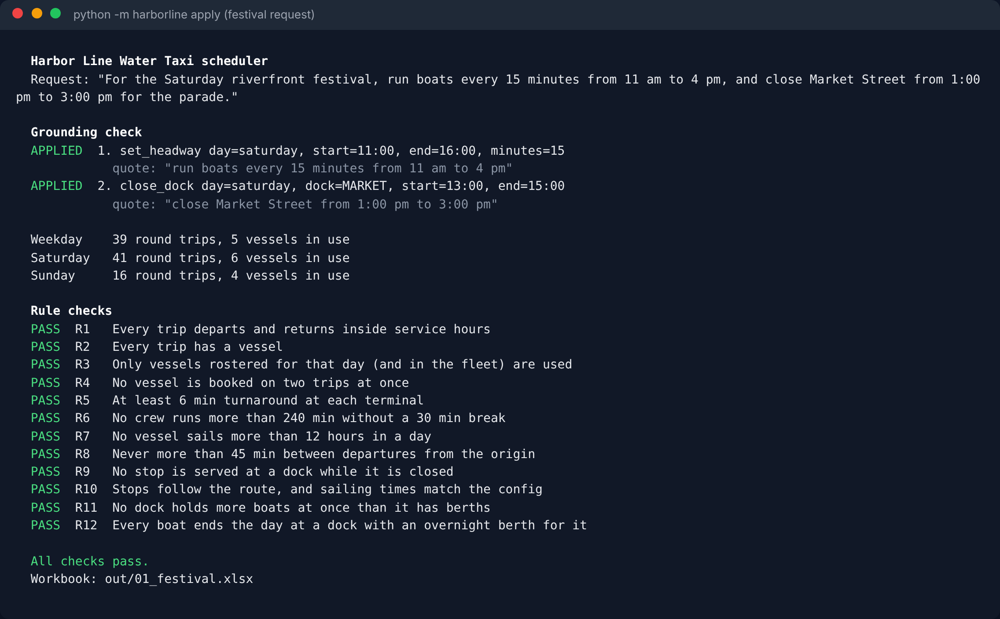
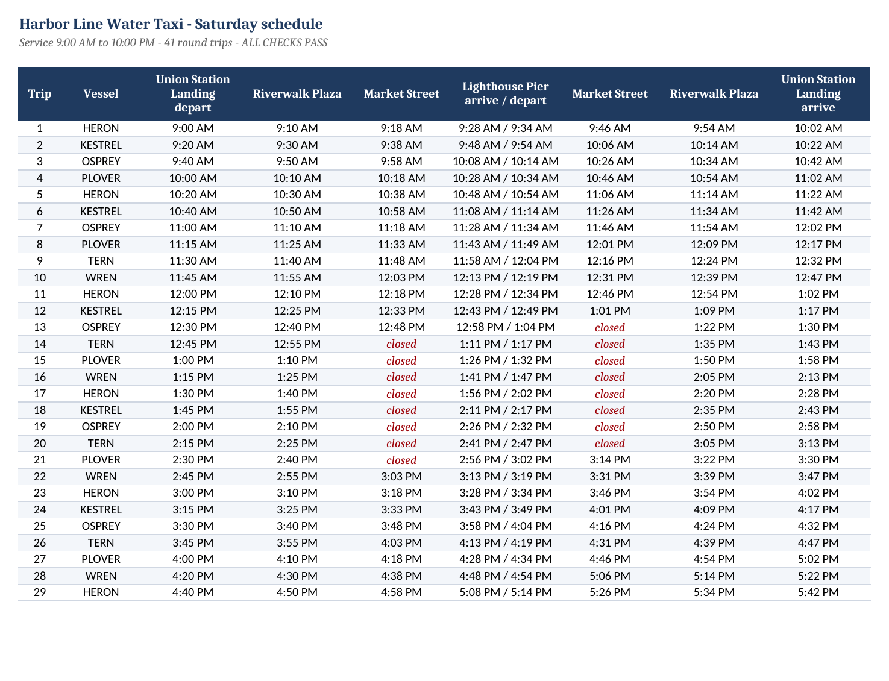
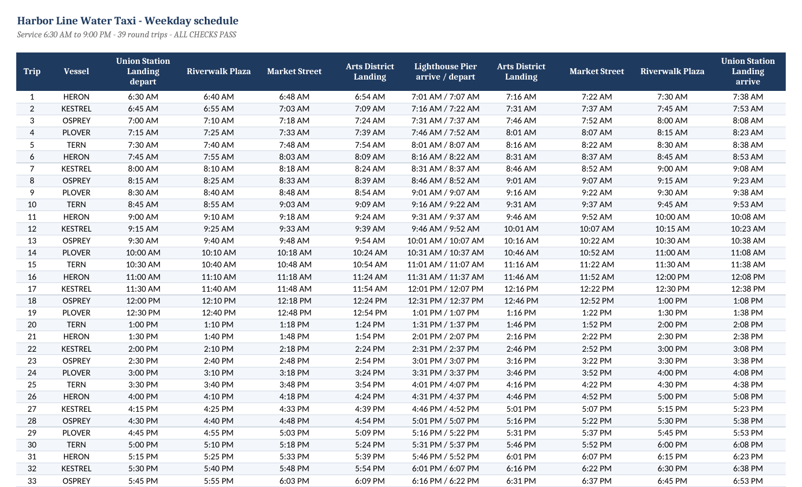
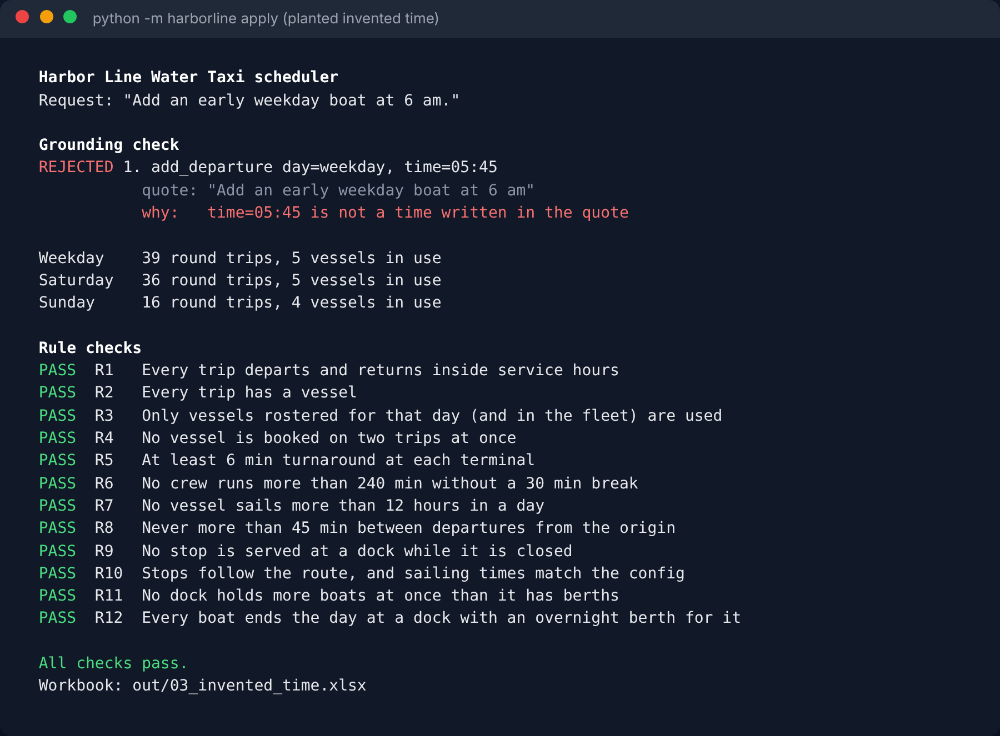
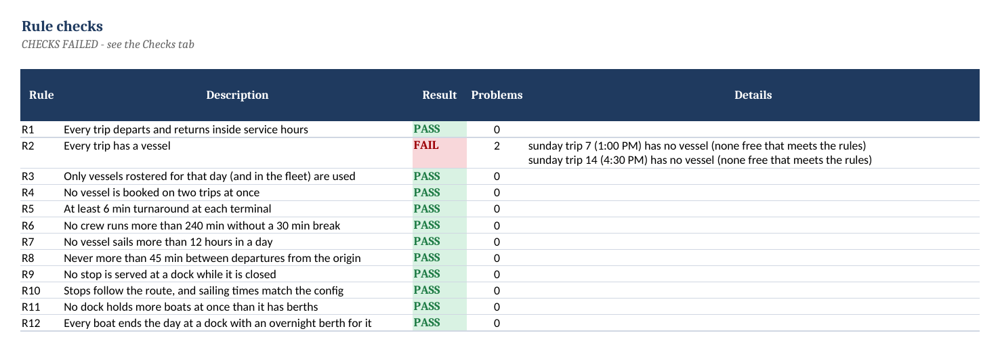

# Harbor Line Water Taxi Scheduler (demo)

A working prototype of an **AI scheduling assistant for a small passenger-ferry fleet**.
A scheduler types a change in plain English ("run boats every 15 minutes from 11 am to
4 pm on Saturday and close Market Street from 1 to 3 pm"). Claude turns it into
structured edits, a Python engine recalculates every time, twelve operating rules are
re-checked, and the result is written to an Excel workbook ready for review.

**Try it live:** [harborline-scheduler.ihlerconsulting.workers.dev](https://harborline-scheduler.ihlerconsulting.workers.dev). The same Python engine runs in your browser. Pick an example, or edit the proposed edits and watch the checks react.

> **Harbor Line Water Taxi is fictional.** The docks, boats, times and rules are made up for this demo.



## Why it is built this way

Language models are good at reading requests and bad at arithmetic they can't check.
So the model is never allowed to write a time into the schedule.

| Step | Who does it | Safeguard |
|---|---|---|
| 1. Read the request | Claude (skill in `skills/harborline-scheduler`) | Must quote the exact words behind every edit |
| 2. Grounding check | Python (`harborline/ops.py`) | Rejects any edit whose quote isn't in the request, or whose times or minute counts aren't written in that quote |
| 3. Build the timetable | Python (`harborline/engine.py`) | All times are calculated from the config: sailing times, dwell, turnarounds |
| 4. Assign boats | Python | Respects crew breaks, daily hours and the day's roster |
| 5. Rule checks | Python (`harborline/checks.py`) | Re-checks the finished schedule from scratch; doesn't trust step 3 or 4 |
| 6. Excel output | Python (`harborline/excel.py`) | One tab per service day, plus Vessels, Checks and a Changes audit trail |

When the request leaves something out ("add a late boat on Saturdays"), the skill asks a
question instead of guessing.

## The twelve rules it checks

| | Rule |
|---|---|
| R1 | Every trip departs and returns inside service hours |
| R2 | Every trip has a vessel |
| R3 | Only vessels rostered for that day are used |
| R4 | No vessel is booked on two trips at once |
| R5 | Minimum turnaround at each terminal |
| R6 | No crew runs more than 4 hours without a 30-minute break |
| R7 | No vessel sails more than 12 hours in a day |
| R8 | Never more than 45 minutes between departures |
| R9 | No stop is served at a dock while it is closed |
| R10 | Stops follow the route, and sailing times match the config |
| R11 | No dock holds more boats at once than it has berths (dock conflicts) |
| R12 | Every boat ends the day at a dock with an overnight berth for it |

The limits live in `data/network.yaml`, so an operator can change them without touching code.

## What it looks like

**Saturday after the festival request:** 15-minute service from 11 AM, Market Street skipped during the parade.



**A new dock is a config change.** "Add Arts District Landing between Market Street and Lighthouse Pier, 4 minutes from Market Street and 7 to Lighthouse Pier" adds a stop to every trip:



**An invented time is rejected.** The request says 6 am; the proposed edit says 5:45. It never reaches the schedule:



**A real problem is flagged, not hidden.** Taking one boat off Sunday leaves two trips without a crew that can legally run them:



## Run it

Python 3.10 or newer.

```bash
pip install -r requirements.txt
python -m harborline build            # baseline schedule -> out/harborline_schedule.xlsx
./run_demo.sh                         # baseline + the four example requests
python -m pytest -q                   # 25 tests, including planted errors
```

### With Claude

- **Claude Code or Cowork:** open this folder and ask for a schedule change. The skill in
  `.claude/skills/harborline-scheduler` tells Claude to write the edit operations,
  run the engine, and report what passed and failed.
- **Anthropic API:** `pip install anthropic`, set `ANTHROPIC_API_KEY`, then
  `python -m harborline ask -r "Close Riverwalk Plaza on Sunday from 2 pm to 4 pm"`.
- **No AI at all:** `python -m harborline apply -r "request" --ops my_ops.json`.

The edit files in `examples/` are samples in the format the skill produces. One of them
contains a deliberately invented time to show the grounding check rejecting it.

## Web demo

`web/index.html` loads this repo's Python package into the browser with [Pyodide](https://pyodide.org), so the
live page runs the exact code the tests cover. `worker/worker.js` is a small Cloudflare Worker that serves the
page (pinned to one commit) and an optional live-Claude endpoint. The endpoint stays off until an
`ANTHROPIC_API_KEY` secret is added, and it's capped per day and per visitor through a KV counter. The key
belongs in its own Anthropic Console workspace with a low monthly spend limit.

## Project layout

```
data/network.yaml          docks, route, sailing times, fleet, rules, service days
harborline/engine.py       timetable and vessel assignment
harborline/checks.py       the twelve rule checks
harborline/ops.py          edit operations and the grounding check
harborline/excel.py        workbook writer
harborline/agent.py        optional Anthropic API call (model proposes, never decides)
skills/harborline-scheduler/SKILL.md   the Claude skill
examples/                  four requests and their edit files
tests/                     25 tests
web/index.html             in-browser demo page
worker/                    Cloudflare Worker (page + rate-limited Claude endpoint)
```

## Limits (it's a demo)

- One out-and-back route from one origin dock. Multiple routes, interlining and
  charters would come next.
- Vessel assignment is a greedy heuristic, not an optimizer. It finds a legal plan when
  there is comfortable slack; the checks catch it when it can't.
- Overnight positions are checked against berth counts, but the engine doesn't yet plan
  positioning runs to send a boat to a different overnight dock.
- Crew rules are simplified to a continuous-duty limit and a break length. Real labor
  rules, Coast Guard manning and crew rosters would need the operator's input.
- No connection to ticketing, AIS or crew systems. Output is Excel only.

## Author

Built by Chris Ihler with Claude Code, November 2026. MIT License.
